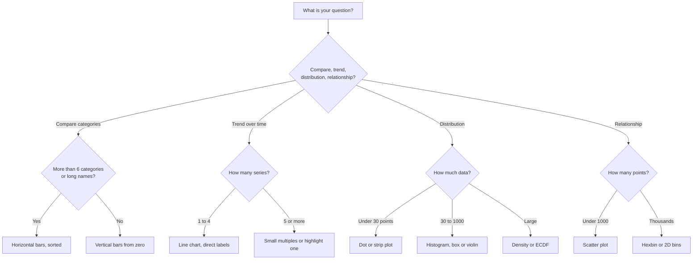

# Choosing a plot

Start from the **question**, not the chart. Ask what you want the reader to see, then pick the chart that shows it with the least effort.

## Step 1. What is the job?

| You want to show... | Reach for | Gallery |
|---|---|---|
| **Change over time** | Line, step, area | [Lines](../gallery/lines-bars.md) |
| **Compare amounts** across categories | Bar (horizontal if names are long), dot plot, lollipop | [Bars](../gallery/lines-bars.md) |
| **Rank** items | Sorted horizontal bars, lollipop, bump chart | [Lines and bars](../gallery/lines-bars.md) |
| **Before and after** | Slope chart, dumbbell | [Lines and bars](../gallery/lines-bars.md) |
| **Distribution** of one variable | Histogram, density, ECDF, box, violin, raincloud | [Statistics](../gallery/statistics.md) |
| **Relationship** of two variables | Scatter, hexbin, regression with band | [Scatter](../gallery/scatter-fills.md) |
| **Part of a whole** | Stacked bar, 100% bar, (rarely) donut | [Pie and polar](../gallery/pie-polar.md) |
| **Flow** between stages | Sankey, stacked bars | [Specialty](../gallery/specialty.md) |
| **Many variables at once** | Small multiples, heatmap, correlation matrix | [Images](../gallery/images-contours.md) |
| **Uncertainty** | Error bars, bands, intervals, forest plot | [Statistics](../gallery/statistics.md) |
| **Two methods agreeing** | Bland-Altman, scatter with identity line | [Statistics](../gallery/statistics.md) |
| **A matrix of values** | Heatmap, confusion matrix | [Images](../gallery/images-contours.md) |
| **A surface or field** | Contour, filled contour, image | [Images](../gallery/images-contours.md) |
| **Geographic** | Map projection | [Layout](../gallery/layout.md) |

## Step 2. How well does the eye read each encoding?

Cleveland and McGill (1984) tested what people judge accurately. From best to worst:

1. **Position on a common scale** (points on one axis, bar ends)
2. **Position on non-aligned scales** (small multiples)
3. **Length** (bars)
4. **Angle and slope**
5. **Area**
6. **Volume, colour saturation and hue**

**So:** use position and length for the numbers that matter, and keep colour for grouping. That is why bars beat pies, and why 3D bars are almost never a good idea.

## Step 3. A decision flow



## Step 4. Common mistakes, and the fix

### Cut axes on bars

Bars encode length, so the baseline must be zero. A cut axis makes a small gap look huge.

<p align="center">


</p>

<p align="center"><sub>Also in <a href="../img/gg/choose-truncated_cream.png">cream</a></sub></p>

<details markdown="1">
<summary>Show the code</summary>

```python
import numpy as np
import pandas as pd
from plotnine import *
import roygbviz as rv

rv.use("light")  # white by default; or "dark", or "cream"

df = pd.DataFrame({"model": ["A", "B", "C"], "wer": [3.1, 3.5, 3.9]})

bad = (ggplot(df, aes("model", "wer")) + geom_col(fill=rv.colour("red"), width=0.6) + coord_cartesian(ylim=(3, 4))
       + labs(title="Misleading: axis starts at 3", x="", y="WER (%)"))
good = (ggplot(df, aes("model", "wer")) + geom_col(fill=rv.colour("teal"), width=0.6)
        + labs(title="Honest: axis starts at 0", x="", y="WER (%)"))
p = bad | good

p.show()  # or: p.save("figure.png", dpi=300)
```

</details>


### Overplotting

Thousands of solid points become a blob. Use transparency, smaller points, or bin the data.

<p align="center">


</p>

<p align="center"><sub>Also in <a href="../img/gg/choose-overplot_cream.png">cream</a></sub></p>

<details markdown="1">
<summary>Show the code</summary>

```python
import numpy as np
import pandas as pd
from plotnine import *
import roygbviz as rv

rv.use("light")  # white by default; or "dark", or "cream"

rng = np.random.default_rng(1)
df = pd.DataFrame({"x": rng.normal(size=10000)}); df["y"] = 0.6 * df["x"] + rng.normal(size=10000)

bad = ggplot(df, aes("x", "y")) + geom_point(colour=rv.colour("red")) + labs(title="Solid points: a blob")
good = ggplot(df, aes("x", "y")) + geom_bin_2d(bins=40) + scale_fill_gradientn(colors=[rv.cmap("blue")(i) for i in np.linspace(0, 1, 7)]) + labs(title="2D bins: the density shows") + theme(legend_position="none")
p = bad | good

p.show()  # or: p.save("figure.png", dpi=300)
```

</details>


### Too many colours

Colour tells groups apart for up to about six or seven categories. After that, use small multiples.

<p align="center">


</p>

<p align="center"><sub>Also in <a href="../img/gg/choose-colours_cream.png">cream</a></sub></p>

<details markdown="1">
<summary>Show the code</summary>

```python
import numpy as np
import pandas as pd
from plotnine import *
import roygbviz as rv

rv.use("light")  # white by default; or "dark", or "cream"

rng = np.random.default_rng(2)
names = [f"m{i}" for i in range(1, 10)]
df = pd.DataFrame([(n, t, np.sin(t / 3 + k) + rng.normal(0, 0.05)) for k, n in enumerate(names) for t in range(30)], columns=["model", "t", "y"])

bad = ggplot(df, aes("t", "y", colour="model")) + geom_line() + scale_colour_manual(values=rv.colour_map(names)) + labs(title="Nine lines in one panel") + theme(legend_position="none")
good = ggplot(df, aes("t", "y")) + geom_line(colour=rv.colour("blue")) + facet_wrap("model", ncol=3) + labs(title="Small multiples") + theme(axis_text=element_blank())
p = bad | good

p.show()  # or: p.save("figure.png", dpi=300)
```

</details>


### Two y axes

A second y axis lets you draw any two lines to cross wherever you like, and the crossing means nothing. Prefer two panels sharing an x axis.

<p align="center">


</p>

<p align="center"><sub>Also in <a href="../img/layout/shared-axes_cream.png">cream</a></sub></p>

<details markdown="1">
<summary>Show the code</summary>

```python
import numpy as np
import matplotlib.pyplot as plt
import roygbviz as rv

rv.use("light")  # white by default; or "dark", or "cream"

rng = np.random.default_rng(7)
fig, axs = plt.subplots(3, 1, figsize=(6.4, 4.6), sharex=True, layout="constrained")
t = np.linspace(0, 10, 200)
for ax, name, c in zip(axs, ("STT", "LLM", "TTS"), ("STT", "LLM", "TTS")):
    ax.plot(t, np.sin(t + len(name)) + rng.normal(0, 0.1, t.size), color=rv.group_map()[c])
    ax.set_ylabel(name)
axs[-1].set_xlabel("time (s)")

plt.show()  # or: fig.savefig("figure.png", dpi=300)
```

</details>


If you must use one, make the units different on purpose and colour each axis like its line:

<p align="center">


</p>

<p align="center"><sub>Also in <a href="../img/layout/twin-axes_cream.png">cream</a></sub></p>

<details markdown="1">
<summary>Show the code</summary>

```python
import numpy as np
import matplotlib.pyplot as plt
import roygbviz as rv

rv.use("light")  # white by default; or "dark", or "cream"

t = np.arange(1, 11)
fig, ax = plt.subplots(figsize=(6.4, 3.8), layout="constrained")
ax.plot(t, 40 / t + 2, "o-", color=rv.colour("red"))
ax.set_ylabel("word error rate (%)", color=rv.colour("red"))
ax2 = ax.twinx()
ax2.plot(t, 0.5 * t ** 1.4, "s-", color=rv.colour("blue"))
ax2.set_ylabel("latency (s)", color=rv.colour("blue"))
ax2.grid(False)
ax2.spines["right"].set_visible(False)
ax.set(xlabel="model size (B parameters)", title="Two y axes with twinx()")

plt.show()  # or: fig.savefig("figure.png", dpi=300)
```

</details>


### Pie charts

Angles are hard to compare. Use a pie only for **two or three** parts where one is clearly a big share (for example half). Otherwise use sorted bars.

## Step 5. Show more than the average

A bar showing a mean hides the data. The same numbers can come from very different distributions, as Anscombe's quartet shows:

<p align="center">


</p>

<p align="center"><sub>Also in <a href="../img/specialty/anscombe_cream.png">cream</a></sub></p>

<details markdown="1">
<summary>Show the code</summary>

```python
import numpy as np
import matplotlib.pyplot as plt
import roygbviz as rv

rv.use("light")  # white by default; or "dark", or "cream"

x = np.array([10, 8, 13, 9, 11, 14, 6, 4, 12, 7, 5])
ys = [np.array([8.04, 6.95, 7.58, 8.81, 8.33, 9.96, 7.24, 4.26, 10.84, 4.82, 5.68]),
      np.array([9.14, 8.14, 8.74, 8.77, 9.26, 8.10, 6.13, 3.10, 9.13, 7.26, 4.74]),
      np.array([7.46, 6.77, 12.74, 7.11, 7.81, 8.84, 6.08, 5.39, 8.15, 6.42, 5.73]),
      np.array([6.58, 5.76, 7.71, 8.84, 8.47, 7.04, 5.25, 12.50, 5.56, 7.91, 6.89])]
xs = [x, x, x, np.array([8] * 7 + [19] + [8] * 3)]
fig, axs = plt.subplots(2, 2, figsize=(6.4, 4.8), sharex=True, sharey=True, layout="constrained")
for ax, xx, yy, n, c in zip(axs.ravel(), xs, ys, "I II III IV".split(), ("red", "teal", "violet", "orange")):
    ax.scatter(xx, yy, color=rv.colour(c), s=30)
    m, b = np.polyfit(xx, yy, 1)
    ax.plot([3, 20], [m * 3 + b, m * 20 + b], color=rv.colour("grey"), lw=1.4)
    ax.set_title(n, fontsize=10)
    ax.set_xlim(2, 20); ax.set_ylim(2, 14)

plt.show()  # or: fig.savefig("figure.png", dpi=300)
```

</details>


For a few dozen points show them all. A raincloud plot combines points, a box and a smoothed shape:

<p align="center">


</p>

<p align="center"><sub>Also in <a href="../img/stats/raincloud_cream.png">cream</a></sub></p>

<details markdown="1">
<summary>Show the code</summary>

```python
import numpy as np
import matplotlib.pyplot as plt
import roygbviz as rv

rv.use("light")  # white by default; or "dark", or "cream"

rng = np.random.default_rng(28)
names = ["Whisper", "Parakeet", "Conformer"]
data = [rng.normal(m, s, 80) for m, s in ((3.1, 0.8), (3.6, 1.0), (4.4, 1.5))]
cm = rv.colour_map(names)
fig, ax = plt.subplots(figsize=(6.2, 3.8), layout="constrained")
vp = ax.violinplot(data, showextrema=False, side="high", widths=0.8)
for b, n in zip(vp["bodies"], names):
    b.set(facecolor=rv.shade(cm[n]), edgecolor=cm[n], alpha=1)
bp = ax.boxplot(data, widths=0.1, positions=[0.82, 1.82, 2.82], showfliers=False, patch_artist=True,
                medianprops=dict(color=plt.rcParams["text.color"], lw=2))
for p, n in zip(bp["boxes"], names):
    p.set(facecolor=rv.shade(cm[n]), edgecolor=cm[n])
for i, (n, d) in enumerate(zip(names, data)):
    ax.scatter(i + 0.62 + rng.uniform(-0.06, 0.06, d.size), d, s=6, color=cm[n], alpha=0.7)
ax.set_xticks([1, 2, 3], names)
ax.set(ylabel="word error rate (%)", title="Raincloud plot")

plt.show()  # or: fig.savefig("figure.png", dpi=300)
```

</details>


## Step 6. Title, labels and direct labels

- **Title states the finding** ("The language model dominates latency"), not the topic ("Latency by stage").
- **Label axes with the unit**: "Response time (ms)".
- **Label lines directly** at their ends when there are fewer than about six; use a legend otherwise.
- **Order categories meaningfully**: by value, by time, by a natural order. Alphabetical is rarely the right order.

## Quick reference: chart by data type

| X | Y | Chart |
|---|---|---|
| Category | Number | Bar, dot, lollipop |
| Time | Number | Line |
| Number | Number | Scatter |
| Number | (count) | Histogram |
| Category | Distribution | Box, violin, strip |
| Category | Category | Heatmap, stacked bar |
| Two numbers | Value | Contour, heatmap |

## Trade-offs to remember

- **Detail vs. clarity.** Showing every point is honest but noisy. Summaries are clean but can hide shape. Often do both.
- **Familiar vs. precise.** A pie feels familiar. A bar is more accurate.
- **One chart vs. many.** Small multiples need more space but remove clutter.

## Sources

- Cleveland, W. S., and McGill, R. (1984). Graphical perception. *Journal of the American Statistical Association*, 79(387), 531 to 554.
- Anscombe, F. J. (1973). Graphs in statistical analysis. *The American Statistician*, 27(1), 17 to 21.
- Weissgerber et al. (2015). Beyond bar and line graphs. *PLOS Biology*, 13(4), e1002128.

**Next:** [Cascade comparisons](cascade.md).
